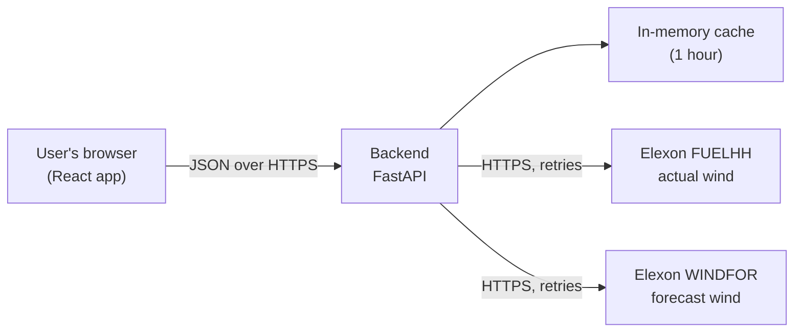

# WindSight: UK Wind Forecast Intelligence

WindSight helps an electricity buying team see **how accurate day-ahead wind forecasts were** for January 2026. It compares Elexon's published wind generation forecasts (WINDFOR) with the wind generation that actually happened (FUELHH), and shows the errors in plain numbers and charts.

## Live demo

| What | Link |
|---|---|
| Dashboard (frontend) | https://anon-web-three.vercel.app |
| API (backend) | https://1k20z83w6v.vercel.app |
| API documentation (interactive) | https://1k20z83w6v.vercel.app/docs |
| Health check | https://1k20z83w6v.vercel.app/health |

**Please read this first:** the backend runs as an on-demand function with an in-memory cache. If nobody has used it for a while, the **first request can take up to about a minute** while it downloads the data from Elexon. After that, requests are fast. If the dashboard shows a loading message for a long time on the first visit, please wait or refresh once.

## Table of contents

1. [Business problem](#business-problem)
2. [Main dashboard features](#main-dashboard-features)
3. [Technology stack](#technology-stack)
4. [High-level architecture](#high-level-architecture)
5. [Project structure](#project-structure)
6. [The Elexon datasets](#the-elexon-datasets)
7. [How the data is processed](#how-the-data-is-processed)
8. [The decision-time cutoff assumption](#the-decision-time-cutoff-assumption)
9. [Time-resolution matching](#time-resolution-matching)
10. [Metric definitions](#metric-definitions)
11. [Example results](#example-results-january-2026)
12. [Known limitations and data-quality considerations](#known-limitations-and-data-quality-considerations)
13. [Running the project locally](#running-the-project-locally)
14. [Running with Docker](#running-with-docker)
15. [Running the tests](#running-the-tests)
16. [Configuration](#configuration)
17. [Deployment](#deployment)
18. [API reference](#api-reference)
19. [AI tools used in development](#ai-tools-used-in-development)

## Business problem

A UK electricity utility buys power on the wholesale market to supply its customers. Wind output depends on the weather, so the buying team relies on wind forecasts when it makes purchasing decisions **one day before delivery**. Forecasts can be wrong: actual generation may turn out higher or lower.

WindSight answers two questions for the buying team:

1. **Which forecast was the latest eligible one when the day-ahead decision had to be made?** For every delivery hour, the dashboard shows the forecast value and when that forecast was published.
2. **How accurate were those forecasts?** It compares each forecast with the actual generation and reports the error in MW, per hour, per day and for the whole month.

WindSight supports human decisions. It does **not** compute the utility's exact remaining purchase requirement (that would need demand and other supply data, which are out of scope), and it is not a trading system.

## Main dashboard features

- **January 2026 overview:** headline accuracy numbers (MAE, RMSE, mean bias, MAPE) and data coverage, plus a plain-language explanation of how the forecast is chosen.
- **Daily forecast accuracy chart:** one bar per day showing that day's mean absolute error, with the month average shown for comparison. Clicking a bar opens that day in the explorer.
- **Days with the largest forecast errors:** shortcuts to the three worst days.
- **Forecast explorer:** pick a delivery date (date field, previous day, next day) and see:
  - that day's metrics next to the month's,
  - a chart of forecast versus actual generation for each hour,
  - a table with the forecast, the actual, the error, **when the forecast was published**, and a data-status label for each hour.
- **Honest handling of missing data:** a missing forecast or an incomplete actual is shown as missing, with a status label. Values are never invented.
- **Readable errors:** if the backend or Elexon cannot be reached, the page shows a clear message instead of failing silently.

## Technology stack

| Part | Technology |
|---|---|
| Frontend | React 19, Vite 8, Recharts 3 (charts), plain CSS; Vitest for tests, oxlint for linting |
| Backend | Python 3.13, FastAPI, Uvicorn, `requests` (with retries) |
| Backend tests | pytest, httpx (FastAPI test client) |
| Containers | Docker and Docker Compose; nginx serves the built frontend |
| Hosting | Vercel (two projects from this one repository) |
| Data source | Elexon BMRS API (public, no key needed) |

## High-level architecture



- The **React app** only displays data. It contains no metric calculations: every number comes from the backend.
- The **FastAPI backend** downloads the two Elexon datasets, cleans and matches them, computes the metrics, and returns JSON.
- Downloaded data is kept in memory for one hour, so repeated page loads do not call Elexon again. Failed downloads are never cached.
- The browser calls the backend directly. The backend allows the frontend's web address through CORS (see [Configuration](#configuration)).

## Project structure

```text
.
├── README.md                    This file
├── docker-compose.yml           Runs backend and frontend together (ports 8000 and 5173)
├── .gitignore
├── backend/
│   ├── Dockerfile               Backend image (Python 3.13, non-root user, health check)
│   ├── .dockerignore
│   ├── .python-version          Python version used by Vercel
│   ├── requirements.txt         Runtime packages (used by Docker and Vercel)
│   ├── requirements-dev.txt     Adds test packages for local development
│   ├── pytest.ini               Test settings
│   ├── live_check_elexon.py     Optional script: checks the real Elexon API from your machine
│   ├── reproduce_january.py     Optional script: re-runs the January analysis and checks it against known values
│   ├── app/
│   │   ├── main.py              Creates the FastAPI app, CORS, error handling, /health
│   │   ├── config.py            Analysis period, cutoff time and other settings
│   │   ├── api/routes.py        The HTTP endpoints (/api/overview, /api/day, /api/accuracy)
│   │   ├── services/
│   │   │   ├── elexon_client.py Downloads data from Elexon (7-day windows, retries, clear errors)
│   │   │   └── data_cache.py    One-hour in-memory cache
│   │   └── analysis/
│   │       ├── processing.py    Cleaning, hourly actuals, forecast selection, hourly table
│   │       └── metrics.py       MAE, RMSE, mean bias, MAPE, per-day summaries
│   └── tests/                   Automated backend tests
├── frontend/
│   ├── Dockerfile               Builds the site, then serves it with nginx
│   ├── nginx.conf               Web server settings (caching, fallback to index.html)
│   ├── .env.example             Shows how to set the backend address
│   ├── package.json             Dependencies and scripts
│   └── src/
│       ├── main.jsx, App.jsx    Application entry point
│       ├── pages/Dashboard.jsx  The dashboard page; owns the selected date
│       ├── components/          MetricCard, OverviewSection, AccuracySection, ExplorerSection,
│       │                        DateSelector, DayMetrics, ForecastChart, DataTable, StatusMessage
│       ├── services/api.js      The only place that calls the backend
│       ├── utils/format.js      Number, time and label formatting
│       └── index.css            Styles
├── scripts/research/            Early scripts used to investigate the Elexon data before the app was built
└── context/                     Project notes: CURRENT_STATE.md, STEP_LOG.md, DECISIONS.md
```

`context/DECISIONS.md` records every important design decision and why it was made.

## The Elexon datasets

Both datasets come from the Elexon BMRS API: `https://data.elexon.co.uk/bmrs/api/v1/datasets/{DATASET}/stream`. The app asks for records using the `publishDateTimeFrom` and `publishDateTimeTo` parameters, in 7-day windows.

| | **FUELHH** (actual) | **WINDFOR** (forecast) |
|---|---|---|
| Meaning | Recorded generation by fuel type | Forecast wind generation |
| Used records | Only `fuelType == "WIND"` | All |
| Resolution | Half-hourly | Hourly |
| `startTime` | The **delivery period** the value is for | The **delivery period being forecast** |
| `publishTime` | When the record was released | When the forecast was released |
| `generation` | Actual generation in MW | Forecast generation in MW |

**`startTime` and `publishTime` mean different things and are never mixed up.** `startTime` says which hour of electricity a record is about. `publishTime` says when that information became available. The cutoff rule below depends on this distinction.

## How the data is processed

All times are timezone-aware and handled in UTC.

1. **Download** actual wind records (published 1 January to 1 February 01:00) and forecast records (published 30 December to 31 January). Elexon problems are retried; temporary errors (server errors, rate limits, network errors) are retried up to three times, other errors are reported immediately.
2. **Skip unusable records.** A record with a missing or invalid time or value is ignored and counted in the log. It never crashes the analysis.
3. **Build hourly actuals** from the half-hourly records (see [Time-resolution matching](#time-resolution-matching)). If Elexon sent duplicates for the same half-hour, the one with the **latest `publishTime`** wins.
4. **Select the forecast for each delivery hour:** the **latest forecast published at or before the decision cutoff**. Forecasts published after the cutoff are ignored, even if they exist. If no forecast was published before the cutoff, the hour has no forecast and is shown as missing; it is never filled from a later forecast.
5. **Build the hourly table:** one row for each of the 744 hours of January 2026, with the forecast, when it was published, the actual, the error, and a status.
6. **Compute the metrics** from the rows that have both a forecast and a complete actual.

**Row statuses:** `ok`, `missing_forecast`, `incomplete_actual`, `missing_actual`, `missing_forecast_and_actual`.

## The decision-time cutoff assumption

The task says the utility decides **one day before delivery** but does not give the exact time. This project **assumes**:

> For a delivery on day D, the decision is made at **09:50 on day D-1** (UK time). Only forecasts published at or before then are eligible.

Example: for delivery on 1 January 2026, the cutoff is 31 December 2025 at 09:50, and the forecast shown is the latest one published up to that moment.

**Why 09:50:** it is the gate closure of the Nord Pool N2EX GB day-ahead auction. The other GB day-ahead auction, EPEX, closes earlier, at 09:20. The sources I found for these times date from 2020 to 2023, so the time is an assumption, not a verified current rule. It is shown on the dashboard so that users can see what the numbers depend on.

**Time zone:** in January, UK local time is GMT, which equals UTC, so 09:50 UK time is 09:50 UTC and no daylight-saving conversion is needed. A test checks this with the Europe/London time zone. Supporting other months would need proper daylight-saving handling.

**Changing it:** edit `DEFAULT_CUTOFF_TIME` and `CUTOFF_DAYS_BEFORE_DELIVERY` in `backend/app/config.py`. All endpoints, the chart and the metrics then use the new cutoff.

## Time-resolution matching

Actuals (FUELHH) are half-hourly and forecasts (WINDFOR) are hourly, so they are compared **hourly**:

- An hourly actual is the **mean of the two half-hour values** (:00 and :30).
- If either half-hour is missing, the hour is marked `incomplete_actual` and has **no** actual value. It is not guessed and it is not counted in the metrics.
- Forecasts are used as published, one value per delivery hour.

## Metric definitions

**Forecast error = forecast generation - actual generation**, in MW. A **positive** error means the forecast was too high (over-forecast). A **negative** error means it was too low (under-forecast).

| Metric | Meaning |
|---|---|
| **MAE** (mean absolute error) | Average size of the error, ignoring direction, in MW. Easy to read: "on average, the forecast was off by this much." |
| **RMSE** (root mean squared error) | Square root of the average squared error, in MW. Like MAE, but large misses count more, so it is higher when there are a few big errors. |
| **Mean bias error** | Average signed error, in MW. Positive means the forecasts tended to be too high overall; negative means too low. Over- and under-forecasts can cancel out here, so read it together with MAE. |
| **MAPE** (mean absolute percentage error) | Average absolute error as a percentage of the actual generation. Hours where actual generation is **below 1 MW** are left out of MAPE only, because dividing by (nearly) zero is meaningless. They are still included in the other metrics. The limit is `MAPE_MIN_ACTUAL_MW` in `config.py`. |

The overview also shows **coverage**: how many of the 744 hours could be compared.

## Example results (January 2026)

With the 09:50 cutoff assumption:

| Metric | Value |
|---|---|
| Hours compared | 744 of 744 (100% coverage) |
| MAE | 2,122.8 MW |
| RMSE | 2,616.7 MW |
| Mean bias | +1,840.3 MW (forecasts were on average higher than actual) |
| MAPE | 22.1% |
| Days with the largest MAE | 28 Jan (5,374.8 MW), 12 Jan (4,900.9 MW), 11 Jan (4,897.1 MW) |

These numbers depend on the cutoff assumption and on the data Elexon serves, which can be revised. They are computed by the backend; none are typed into the frontend.

## Known limitations and data-quality considerations

- **The cutoff is an assumption** (see above). A different cutoff changes which forecast is used and so changes the results.
- **Only January 2026**, national level, wind only. The period is set in `config.py`, and other months would need daylight-saving handling.
- **Hourly comparison.** The half-hourly detail of the actuals is averaged away.
- **Missing data is shown, not repaired.** Missing forecasts and incomplete actual hours are excluded from the metrics and labelled in the table. Coverage is shown so that users can judge the metrics.
- **MAPE excludes near-zero actuals** (below 1 MW) and can be large when actual wind is low.
- **Duplicate actual records** are resolved by taking the latest `publishTime`. Malformed records are skipped and logged.
- **Not a procurement calculator.** No demand, price or other generation data is used, so the app cannot say how much electricity the utility must buy.
- **Depends on the Elexon API.** If Elexon is down or slow, the backend answers with a clear error (HTTP 502) and the dashboard shows it. Data is cached per backend instance for one hour.
- **Slow first request.** The cache is in memory on a hosted function, so after idle time or a redeploy the first request downloads from Elexon again, taking up to about a minute.
- **No login and no database.** The data is public and re-downloaded when needed.
- **Hosting plan.** Vercel's free Hobby plan is meant for non-commercial use, which suits this assessment but would need a paid plan for real commercial use.

## Running the project locally

You need **Python 3.13** and **Node.js 22** (with npm). From the project root:

**1. Backend**

```bash
python -m venv .venv
# Windows PowerShell:  .\.venv\Scripts\Activate.ps1
# macOS / Linux:       source .venv/bin/activate

cd backend
python -m pip install -r requirements-dev.txt
python -m uvicorn app.main:app --reload
```

The API is now at http://127.0.0.1:8000 (interactive docs at http://127.0.0.1:8000/docs). The first data request takes up to a minute.

**2. Frontend** (in a second terminal)

```bash
cd frontend
npm install
npm run dev
```

Open http://localhost:5173. The frontend talks to `http://127.0.0.1:8000` by default; see [Configuration](#configuration) to change that.

## Running with Docker

You need Docker Desktop (or Docker Engine with Compose). Stop any local backend or frontend dev servers first, because the ports are the same.

```bash
docker compose up --build
```

- Dashboard: http://localhost:5173
- API docs: http://localhost:8000/docs

Check the state with `docker compose ps` (both services should become `healthy`). Stop with `docker compose down`.

How it works:

- The **backend** image uses `python:3.13-slim`, runs as a non-root user and has a health check on `/health`.
- The **frontend** image is built in two stages: Node builds the site, then nginx serves only the finished static files.
- The frontend waits until the backend reports healthy.
- The browser (not the container) calls the backend, so the address baked into the frontend is `http://localhost:8000`. It is set in `docker-compose.yml` as a build argument. To use another address, change it there and rebuild.

## Running the tests

**Backend** (from `backend`, with the virtual environment active and `requirements-dev.txt` installed):

```bash
python -m pytest -v
```

Expected: **79 passed**. The tests cover the Elexon client (retries and errors), the processing rules (cutoff selection, hourly matching, duplicates, missing and malformed data), the metrics, the API endpoints, CORS, and a time-zone check. No test calls the real Elexon API.

**Frontend** (from `frontend`):

```bash
npm test
npm run lint
npm run build
```

Expected: **16 tests passed**, no lint errors, and a successful build.

**Optional live checks** against the real Elexon API (from `backend`):

```bash
python live_check_elexon.py
python reproduce_january.py
```

## Configuration

| Setting | Where | Purpose |
|---|---|---|
| `CORS_ORIGINS` | Backend environment variable | Comma-separated web addresses allowed to call the API from a browser. Default: `http://localhost:5173,http://127.0.0.1:5173`. Example for production: `https://your-frontend.vercel.app,http://localhost:5173` (no trailing slashes). |
| `VITE_API_BASE_URL` | Frontend build-time variable | Address of the backend. Default: `http://127.0.0.1:8000`. For local changes, copy `frontend/.env.example` to `frontend/.env`. It is **public** (it ends up in the website files), so never put secrets in it. |
| Cutoff, analysis period, MAPE limit | `backend/app/config.py` | Analysis settings (see above). |

No secrets or API keys are used anywhere: the Elexon API is public.

## Deployment

The app is hosted on **Vercel** as two projects created from this repository:

| Project | Root directory | Preset | Environment variable |
|---|---|---|---|
| Backend | `backend` | FastAPI | `CORS_ORIGINS` = the frontend's address (plus `http://localhost:5173`) |
| Frontend | `frontend` | Vite | `VITE_API_BASE_URL` = the backend's address |

Both projects redeploy automatically when changes are pushed to `main`. Environment variables only apply to new deployments, so after changing one, redeploy that project. `VITE_API_BASE_URL` is read when the frontend is built.

## API reference

Interactive documentation: `/docs` on the backend. All endpoints use GET and return JSON.

| Endpoint | Returns |
|---|---|
| `/health` | `{"status": "ok", "service": "windsight-backend"}` |
| `/api/overview` | The analysis period, the cutoff assumption (time and explanation), and the monthly metrics with coverage |
| `/api/accuracy` | The monthly metrics plus metrics for every delivery date |
| `/api/day?date=YYYY-MM-DD` | One delivery date: the cutoff used, that day's metrics, and 24 hourly rows (forecast, publish time, actual, error, status) |

Errors are always `{"detail": "..."}`: `400` for a date outside 1 to 31 January 2026, `422` for a badly formatted date, `502` when Elexon cannot be reached, `500` for an unexpected processing error.

## AI tools used in development

This project was built with substantial help from AI tools. I am disclosing this openly.

- **Claude (Anthropic)** was used as a development mentor and pair programmer throughout. It helped with investigating the Elexon data, designing the processing and cutoff logic, writing the backend, the frontend, the tests, the Docker setup and this README, and planning the Vercel deployment. It also researched the day-ahead market closing times used for the cutoff assumption. Claude drafted code and documents step by step; I ran the commands, tested each step, reported the results, and decided what to keep.

What I verified myself: I ran the backend and frontend locally, ran the tests, ran the Docker setup, deployed to Vercel, and checked the deployed dashboard in a browser. The cutoff time and the other assumptions listed above should be read as design choices that I can explain and that are open to change, not as facts supplied by the data.